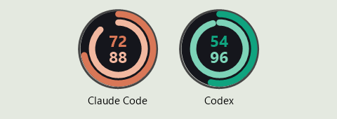

# My AI Quota Ring

Windows 11 工作列上的 AI 額度圓環：左邊是 Claude Code（橘色），右邊是 Codex（綠色）。外圈顯示每週額度，內圈顯示 5 小時額度，圓心寫剩餘百分比。右鍵圓環可以切換帳號。

## 畫面



示意圖使用範例額度。

| 位置 | 意義 |
|---|---|
| 左邊橘色圓環 | Claude Code 額度 |
| 右邊綠色圓環 | Codex 額度 |
| 外圈、上方數字 | 每週額度剩餘百分比 |
| 內圈、下方數字 | 5 小時額度剩餘百分比 |

操作方式：

- 滑鼠停在圓環上：顯示詳細額度、重置時間，或無法取得額度的原因。
- 右鍵圓環：切換 Claude Code 或 Codex 的登入帳號。

> 給 AI 代理：照「安裝流程」由上往下做。每一步先檢測，缺少「必要」的項目就停下來告訴使用者；「選用」的項目缺了就略過，並在最後回報。不要修改原始碼。

## 環境檢測

| 項目 | 必要性 | 檢測指令 | 缺少時 |
|---|---|---|---|
| Windows 11 x64 | 必要 | `[Environment]::OSVersion.Version`（Build ≥ 22000）、`$env:PROCESSOR_ARCHITECTURE` = `AMD64` | 無法使用，停止 |
| .NET 10 SDK | 必要（從原始碼建置） | `dotnet --list-sdks` 有 `10.` 開頭的版本 | `winget install Microsoft.DotNet.SDK.10` |
| Codex 桌面版（已登入） | 選用：Codex 圓環 | `Test-Path "$env:LOCALAPPDATA\OpenAI\Codex\bin\*\codex.exe"` | Codex 圓環顯示灰圈 |
| Claude Code 登入（桌面版或 CLI） | 選用：Claude 圓環 | `Test-Path "$env:USERPROFILE\.claude\.credentials.json"`（有設定 `CLAUDE_CONFIG_DIR` 時改查該目錄） | Claude 圓環顯示灰圈 |
| Claude Code CLI | 選用：權杖過期時自動刷新 | `Test-Path "$env:USERPROFILE\.local\bin\claude.exe"` 或 `Get-Command claude` | 權杖過期後要手動開 Claude Code 重新登入 |

Codex 和 Claude Code 至少要有一個，否則兩個圓環都是灰的，裝了也沒有用。

## 安裝流程

在 repo 根目錄用 PowerShell 執行：

```powershell
powershell -ExecutionPolicy Bypass -File .\install.ps1
```

腳本會做這些事：

1. 確認有 .NET 10 SDK。
2. 結束執行中的 QuotaRing。
3. 把自帶 runtime 的單一執行檔發佈到 `%LOCALAPPDATA%\Programs\QuotaRing\QuotaRing.exe`。
4. 啟動程式。程式啟動時會自動建立開機啟動捷徑 `shell:startup\QuotaRing.lnk`。

## 驗證

```powershell
Get-Process QuotaRing
Test-Path "$([Environment]::GetFolderPath('Startup'))\QuotaRing.lnk"
& "$env:LOCALAPPDATA\Programs\QuotaRing\QuotaRing.exe" --self-test; $LASTEXITCODE
```

- 前兩行都要有結果，工作列也要出現圓環。
- `--self-test` 回傳 `0` 表示 Codex 額度讀取正常。沒裝 Codex 時回傳非 0 是正常的。

## 更新與移除

- 更新：`git pull` 後再執行一次 `install.ps1`。
- 移除：`powershell -ExecutionPolicy Bypass -File .\uninstall.ps1`。加上 `-KeepSettings` 可以保留設定。帳號快照不會刪除。

## 執行時會用到的路徑

| 路徑 | 用途 |
|---|---|
| `%LOCALAPPDATA%\QuotaRing\` | 設定檔與記錄檔，不含登入資料 |
| `%USERPROFILE%\.claude-accounts\`、`%USERPROFILE%\.codex-accounts\` | 帳號切換的登入快照，含權杖，不要同步或分享 |

## 圓環狀態

- 青色圓點：剩餘 20% 以下。
- 黃色圓點：暫時無法更新，畫面顯示的是上一次成功取得的資料。
- 灰圈加上 `--`：無法取得額度。滑鼠停在圓環上可以看到原因。

## 額度資料來源

- Codex：本機 `codex app-server` 的 `account/rateLimits/read`。
- Claude Code：用本機權杖查 `https://api.anthropic.com/api/oauth/usage`，最多每 60 秒查一次。這個介面沒有公開文件，之後可能會變動。

## 開發

```powershell
dotnet build QuotaRing.slnx -c Release
```

## 授權

MIT，見 [LICENSE](LICENSE)。
